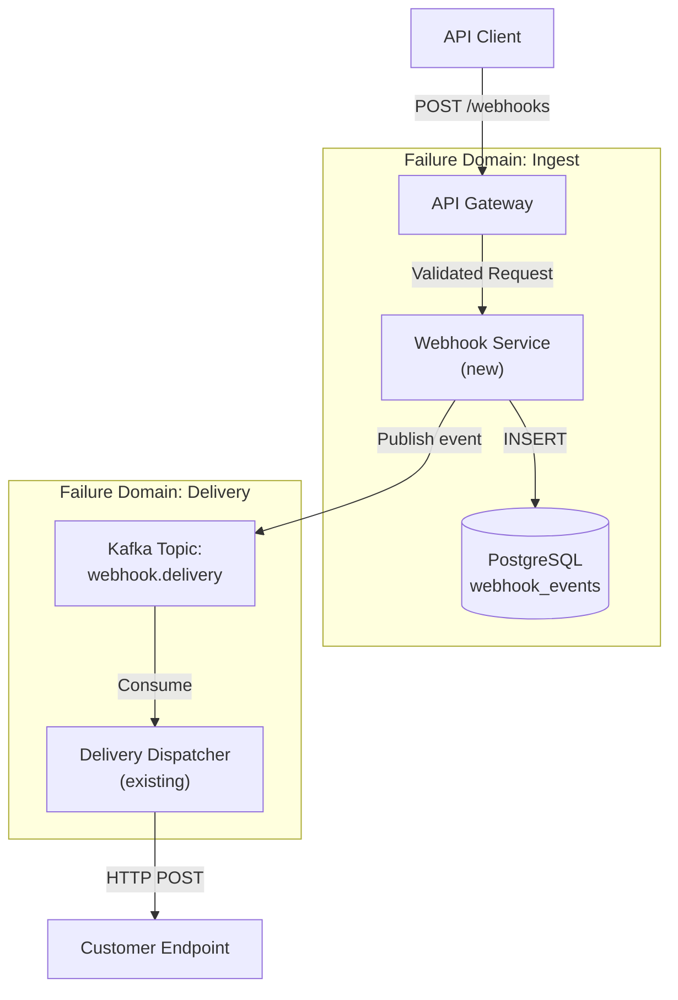

# Phase 5: Solution Design

You are in the solution design phase of the Software Architect Agent workflow. By this point you have a clear problem understanding and gathered context from existing systems, product scope, and codebase analysis. Now you design the candidate solutions.

**Read the temp file in full before writing a single solution.** Every proposal must be grounded in the context you gathered — not in theoretical best practices disconnected from the actual environment.

---

## Step 1: Synthesize Context Before Designing

Before generating proposals, spend one deliberate pass reviewing:

1. **Problem constraints** — what must every solution accommodate? (timeline, team, tech stack, regulatory)
2. **Existing system landscape** — what are you building on top of, beside, or instead of?
3. **Product requirements** — which acceptance criteria are non-negotiable?
4. **Codebase realities** — what patterns are in use? what tech debt might compound?
5. **Assumptions in play** — what are the shakiest assumptions? which solutions depend on them?

Note what you are optimizing for: "Given this context, solutions are ranked primarily by [criterion], with secondary consideration for [criterion]." State this explicitly so reviewers understand your framing.

---

## Step 2: Generate Solution Proposals

Generate a **minimum of 2, maximum of 4** solution proposals.

### The Simplest Path is Mandatory

**ALWAYS include a "Simplest Path" solution as one of your proposals.** This is non-negotiable.

The Simplest Path solution:
- Achieves the business objective with the least new infrastructure, code, or process
- Asks: "What if we modified an existing service? Added a database column? Used an existing library? Changed a config?"
- Is not a throwaway — present it as a genuine candidate with full analysis
- Is frequently the right answer; the job of the other proposals is to show when it is not
- Its existence disciplines the other proposals — each more complex option must justify its added complexity

If the Simplest Path genuinely cannot meet the success criteria, say so clearly in the Arguments AGAINST section. That is useful analysis, not a failure.

### Naming Solutions

Name each solution descriptively, not generically. Avoid "Option A / Option B."

Good names anchor the solution to its core idea:
- "Extend Existing Notification Service" (not "Option 1")
- "Event-Driven Fan-Out via Kafka" (not "Option 2")
- "Dedicated Webhook Delivery Sidecar" (not "Option 3")

The name should communicate the fundamental approach at a glance.

---

## Step 3: For Each Solution, Produce ALL Subsections

Every proposal must include all of the following subsections. Do not skip any. A proposal missing subsections is incomplete.

---

### 5.N.1 Overview

Write a single cohesive paragraph describing the approach. It should be comprehensible to a technical stakeholder who reads only this paragraph.

Specifically answer:
- What is the core idea?
- What existing things does it reuse vs. introduce?
- What is the fundamental bet this approach makes? (e.g., "This bets that our event throughput will stay under 50K/day for 18 months")

---

### 5.N.2 Architecture Diagram (Mermaid)

Include a Mermaid diagram for every solution. The diagram must show:

- **Components**: every service, datastore, queue, and external system involved
- **Data flows**: labeled arrows showing what data moves between components and in which direction
- **Integration boundaries**: clearly distinguish between systems owned by this team vs. external systems
- **Failure domains**: group components that fail together (dashed borders or cluster notation)

Use `flowchart TD` or `flowchart LR` depending on which better illustrates the topology. Label every arrow with what flows across it (event type, API call name, data entity).



The above is an example — produce a diagram specific to each solution.

---

### 5.N.3 How It Works

#### Data Flow
Walk through the data from origin to final resting place:
- Where does data enter the system?
- What transformations occur and where?
- What is written to which datastore, and when?
- What events are emitted, and who consumes them?
- What is the consistency model? (eventual? strong? at-least-once? exactly-once?)

#### Control Flow
Walk through the execution path for the primary scenario:
- What triggers the operation?
- What sequence of service calls, database operations, and decisions occurs?
- Who is the synchronous caller? Who is the asynchronous consumer?
- How are errors handled at each step?

#### Key Components

| Component | Responsibility | New vs. Existing | Owner |
|-----------|---------------|------------------|-------|
| [name] | [what it does] | New / Existing / Modified | [team] |

#### Integration Points

| System | Integration Mechanism | Data Exchanged | Direction |
|--------|-----------------------|---------------|-----------|
| [system] | REST / Event / Queue / DB view | [data] | Inbound / Outbound / Both |

---

### 5.N.4 Arguments FOR This Approach

Structure arguments across four dimensions. All four must be addressed.

**Technical merits**
- What technical properties make this approach sound? (consistency guarantees, latency characteristics, proven patterns)
- What does this leverage that already exists and works?

**Business alignment**
- How does this approach serve the business objective?
- Does it deliver value incrementally or all at once?
- How does it align with the product timeline?

**Organizational fit**
- Does this approach align with team ownership boundaries?
- Can the team who will build it do so with their current skill set?
- Does it follow the patterns already in use in the codebase (reducing onboarding cost)?

**Operational characteristics**
- What makes this easier to run, monitor, and debug?
- Does it reduce or maintain current operational burden?
- Does it degrade gracefully, or fail clean?

---

### 5.N.5 Arguments AGAINST This Approach

Be equally rigorous here. A document that only argues for its proposals is advocacy, not architecture.

**Technical risks**
- What could break? Under what conditions?
- What edge cases or failure modes are hard to handle?
- What assumptions must hold for this to work at scale?

**Complexity cost**
- What new infrastructure, concepts, or operational procedures does this introduce?
- What is the ongoing cognitive load for the team maintaining this?
- What would it take for a new engineer to understand and debug this system at 2am?

**Organizational friction**
- Does this require cross-team coordination? Who are the dependencies?
- Does this approach create future ownership confusion?
- Does this fight the org structure (Conway's Law)?

**Failure scenarios**
- What is the single most likely way this approach fails?
- What is the worst-case failure scenario? Is recovery possible?

---

### 5.N.6 Failure Mode Analysis

| Failure Scenario | Impact | Detection | Recovery | Blast Radius |
|-----------------|--------|-----------|----------|--------------|
| [e.g., Queue consumer crashes mid-delivery] | [e.g., Delayed delivery, possible duplicate on restart] | [e.g., Consumer lag metric alert] | [e.g., Restart consumer; idempotency key prevents duplicates] | [e.g., Delivery delay for all queued events; no data loss] |

Cover at minimum:
- The most likely partial failure (a component crashes mid-flow)
- A cascading failure (one failure causes a second system to fail)
- A data consistency failure (state is left incorrect after an error)
- A dependency failure (an external system is unavailable)

---

### 5.N.7 Reversibility Assessment

Classify every significant decision point in this solution as a one-way or two-way door.

**One-way doors** (expensive or risky to reverse — require deep analysis before committing):
- [decision] — Why it's hard to reverse: [reason]. Reversal cost: HIGH / MEDIUM

**Two-way doors** (can be changed later without major cost — pragmatic defaults are fine):
- [decision] — Why it's safe to defer or change: [reason]

Guidance:
- Data model changes (schema changes, new datastores) are almost always one-way doors
- Service splits or new service introductions are usually one-way doors
- API contract choices are one-way doors if external consumers are involved
- Configuration choices, library selections, and deployment topology are usually two-way doors

---

### 5.N.8 Operational Impact

- **On-call burden**: Will this increase alert noise? Introduce new failure modes that require manual intervention?
- **Monitoring requirements**: What new metrics, dashboards, and alerts must be created? What SLOs apply?
- **Deployment complexity**: How does this affect the deployment pipeline? Are there new infrastructure dependencies (new queue, new datastore) that require provisioning?
- **Team cognitive load**: What does a new engineer need to learn to own this component?
- **Documentation requirements**: What documentation must exist for this to be safely operable?

---

### 5.N.9 Implementation Sketch

| Phase | Description | Effort | Dependencies | Parallelizable? |
|-------|------------|--------|-------------|-----------------|
| 1 | [e.g., Schema migration + basic API] | S / M / L / XL | [none] | — |
| 2 | [e.g., Consumer + delivery logic] | M | Phase 1 complete | No |
| 3 | [e.g., Monitoring + runbooks] | S | Phase 2 complete | Yes with Phase 2 |

Effort sizing:
- **S** (Small): 1-3 days engineering
- **M** (Medium): 1-2 weeks
- **L** (Large): 2-6 weeks
- **XL** (Extra Large): 6+ weeks, likely requires multiple engineers

Note which phases can be delivered as independent increments of value.

---

## What Makes a Good Solution Proposal

A strong proposal:
- Is grounded in the gathered context — it references specific existing systems, constraints, and codebase findings
- Makes its core bet explicit — states what assumption must hold for this to be the right choice
- Includes a Mermaid diagram that adds information the text does not already convey
- Has non-trivial Arguments AGAINST — if it's hard to find weaknesses, look harder
- Has a Failure Mode Analysis that covers realistic scenarios, not just theoretical ones
- Gives an honest Reversibility Assessment — does not minimize one-way doors

A weak proposal:
- Could apply to any problem — it reads like a generic description of an architecture pattern
- Has Arguments FOR that are just restating the approach ("it uses events, so it's scalable")
- Has Arguments AGAINST that are trivial ("requires some additional code")
- Skips the Failure Mode Analysis or lists only unlikely catastrophic scenarios
- Does not connect the Implementation Sketch to actual team capacity or timeline constraints

---

## Persist Solutions

Append to the temp file under:

```markdown
## Solution Proposals

### Solution 1: [Descriptive Name] — Simplest Path

[All subsections 5.1.1 through 5.1.9]

---

### Solution 2: [Descriptive Name]

[All subsections]

---

### Solution N: [Descriptive Name]

[All subsections]
```

---

## After Completing This Phase

Confirm all solution proposals are written to the temp file. Proceed to Phase 6: Trade-off Analysis.
